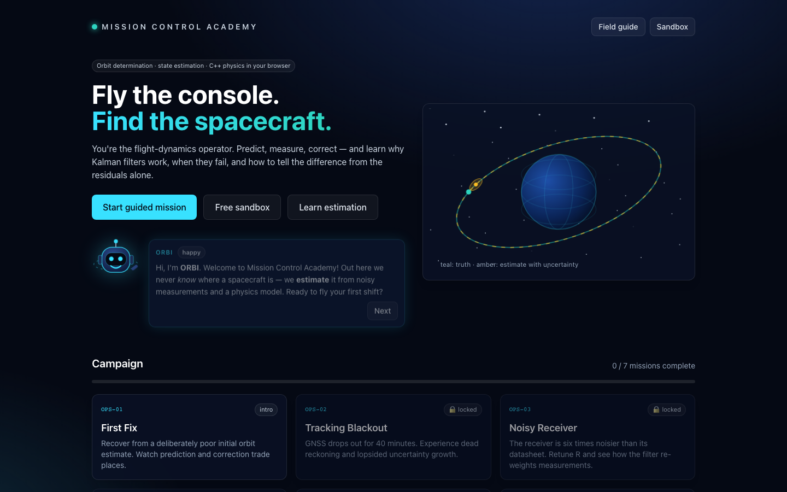
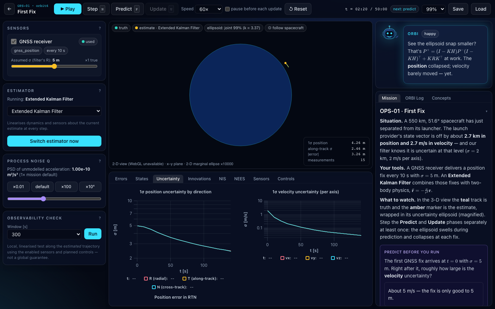

# Mission Control Academy

An educational **orbit-determination and state-estimation simulator** for undergraduate
engineering students. You play a flight-dynamics operator: inspect the estimate and its
uncertainty, make a prediction, choose sensors and filters, run the mission, read the
innovations, and get a debrief that scores **accuracy, uncertainty calibration, tracking
cost and mission success separately**.

All orbital dynamics, numerical integration, measurement generation and estimation are
implemented in **C++20** (Eigen) and compiled to **WebAssembly**. The browser app (React +
TypeScript + Vite + Tailwind, three.js via react-three-fiber, uPlot) only renders and talks to
the core through a Web Worker. Nothing calls the Python reference code.




## What it teaches

| Mission | Concept |
|---|---|
| **First Fix** | Predict–update loop, Kalman gain, why one position fix doesn't give velocity |
| **Tracking Blackout** | Dead reckoning, along-track uncertainty growth, P/V correlation |
| **Noisy Receiver** | True vs assumed noise, NIS, measurement weighting |
| **Planned Burn** | Known impulsive maneuvers with execution uncertainty, event ordering |
| **Unexpected Burn** | Detecting model mismatch from innovations; recovering with Q (truth hidden) |
| **Sensor Geometry Challenge** | Observability (rank, conditioning), range-only vs range+bearing, attitude from thrust |
| **Filter Showdown** | EKF vs UKF vs particle filter vs linear KF on one seed; why a frozen KF diverges |

Plus a free **sandbox** (every scenario, every control), a **Field Guide** of concept cards,
and **ORBI**, a rule-driven mission assistant (no AI service, no API keys).

## Quick start

Prerequisites and exact versions are in [docs/REQUIREMENTS.md](docs/REQUIREMENTS.md). In short:
a C++20 compiler, CMake ≥ 3.21, Ninja, Emscripten 4.0.10, Node ≥ 20.11.

```bash
cd simulations/orbital

# 1. Native core + tests (Eigen, nlohmann/json, doctest are fetched and hash-checked)
cmake --preset native
cmake --build --preset native
ctest --preset native            # 10 CTest targets, 3 700+ assertions

# 2. WebAssembly core (needs an activated emsdk: source <emsdk>/emsdk_env.sh)
cmake --preset wasm
cmake --build --preset wasm      # -> build/wasm/core/osim.mjs + osim.wasm

# 3. Web app
cd web
npm ci
npm run dev                      # http://localhost:5173 (copies the wasm module first)
```

On this machine the toolchains were installed locally (they are git-ignored):

```bash
export PATH="$PWD/.tools/venv/bin:$PATH"   # CMake 3.31.6 + Ninja
source .tools/emsdk/emsdk_env.sh            # Emscripten 4.0.10
```

### Other commands

| Purpose | Command (from `simulations/orbital/`) |
|---|---|
| Run one scenario headless, print summary JSON | `build/native/core/osim_cli scenarios/first_fix.json` |
| Same with another estimator / CSV export | `osim_cli scenarios/filter_showdown.json --estimator ukf --csv out.csv` |
| Observability report at t = 0 | `osim_cli scenarios/first_fix.json --observability 60` |
| Run every scenario (regression smoke) | `build/native/core/osim_cli --check-all scenarios` |
| WASM ↔ native comparison | `node scripts/wasm_integration_test.mjs` |
| Sanitizer build | `cmake --preset native-debug && cmake --build --preset native-debug && ctest --preset native-debug` |
| Frontend lint / types / unit tests | `cd web && npm run lint && npm run typecheck && npm test` |
| Validate authored lesson content | `cd web && npm run validate:content` |
| Production build + preview | `cd web && npm run build && npm run preview` |
| Browser smoke tests (uses installed Chrome) | `cd web && npx playwright test` |
| Regenerate the PDF of the implementation report | `cd web && node scripts/report-pdf.mjs` |

## Architecture in one picture

```
 content/ (lessons, rules, bot, concepts — JSON)      scenarios/ (JSON, shared with C++ tests)
        │                                                     │
        ▼                                                     ▼
 ┌───────────── web/ (React, main thread) ─────────────┐   ┌──────── core/ (C++20) ─────────┐
 │ WelcomeScreen · MissionControl · LearnScreen         │   │ dynamics  integrators  frames  │
 │ lessons/engine (rules, objectives) · scoring         │   │ sensors   estimators   diagnostics
 │ OrbitView (three.js) · PlotPanel (uPlot)             │   │ simulation (nodes, events,     │
 │        ▲ packed Float64Array deltas + JSON           │   │  actions, replay hash)         │
 │        │                                             │   │ bindings/ (embind) ─► osim.wasm│
 │ sim/worker.ts  ◄──────── osim.mjs / osim.wasm ───────┼───┘ apps/osim_cli (headless)      │
 └──────────────────────────────────────────────────────┘   └────────────────────────────────┘
```

Details: [docs/ARCHITECTURE.md](docs/ARCHITECTURE.md).

## Mathematical model (summary)

- ECI Cartesian frame, SI units, double precision, explicit epoch; ECEF by sidereal rotation.
- Two-body point-mass gravity through a composable `ForceModel` interface.
- `orbit6` [r, v]; `rigid12` [r, v, ZYX Euler, body rates] (from the user's Python model, uniform
  sphere by default); `cw6` Clohessy–Wiltshire relative motion (an honestly linear lab).
- RK4 with configurable step; Φ, Γ and Q_d from variational equations integrated with the
  same RK4 stages (Φ is the exact Jacobian of the discrete map).
- Process noise as a continuous PSD (correct elapsed-time scaling) plus zero-order-hold
  control-telemetry noise.
- EKF with Joseph update and LDLᵀ solves; UKF (α = 1, β = 2, κ = 0); bootstrap PF with
  regularised resampling and reported safeguards; linear KF (reference-trajectory or frozen
  linearisation — clearly labelled as not exact for two-body motion).

Full equations: [docs/MATH_AND_UNITS.md](docs/MATH_AND_UNITS.md).

## Limitations (read before teaching with it)

- Gravity is point-mass only (J2, drag, SRP, third-body are documented extension points, not implemented).
- Spherical, uniformly rotating Earth; no precession/nutation/polar motion; ground stations on a sphere.
- GNSS is modelled as a position (or position+velocity) navigation fix, not raw pseudoranges.
- The 12-state attitude uses ZYX Euler angles (guarded near gimbal lock; quaternion migration documented).
- Constant mass and inertia; thrust through the centre of mass.
- The particle filter uses linearised Q_d for its process noise and has safeguards (counted and reported) that make it a pragmatic hybrid at collapse events.
- NEES/NIS time averages are correlated in time; the rigorous Monte-Carlo test lives in the C++ suite.
- Replays are bit-identical within one build; native vs WebAssembly agree to ~10⁻¹¹ relative but not bit-for-bit (different libm).
- Interactive 3-D performance could not be measured on the development machine (no GPU); the
  3-D view was verified to render with software WebGL, and a 2-D fallback is used automatically when WebGL is unavailable.

## Adding missions and lessons

Lessons are JSON files in `content/lessons/`; rules, bot dialogue and concept cards live
next to them. No React code changes are needed. See
[docs/LESSON_AUTHORING.md](docs/LESSON_AUTHORING.md) and the worked example in
[docs/EXTENDING.md](docs/EXTENDING.md).

## Continuous integration

`.github/workflows/orbital-simulator-ci.yml` (at the repository root, path-filtered to
`simulations/orbital/**`) builds and tests the native core on Linux and macOS, runs the
sanitizer build, builds the WebAssembly module and compares it with native, then lints,
type-checks, unit-tests, builds and browser-tests the frontend. See
[docs/REQUIREMENTS.md](docs/REQUIREMENTS.md#continuous-integration) for how to read the checks.

## Documentation

| Document | Contents |
|---|---|
| [docs/REQUIREMENTS.md](docs/REQUIREMENTS.md) | Toolchains, versions, reproducible setup, CI |
| [docs/ARCHITECTURE.md](docs/ARCHITECTURE.md) | Modules, interfaces, scenario schema, event ordering, data flow |
| [docs/MATH_AND_UNITS.md](docs/MATH_AND_UNITS.md) | Frames, states, equations, discretisation, estimators, statistics |
| [docs/LESSON_AUTHORING.md](docs/LESSON_AUTHORING.md) | Lesson/rule/dialogue schema and condition language |
| [docs/VALIDATION.md](docs/VALIDATION.md) | What is tested, against which independent references, results |
| [docs/EXTENDING.md](docs/EXTENDING.md) | Adding a lesson, a force model, a sensor, an estimator |
| [docs/BUILD_JOURNAL.md](docs/BUILD_JOURNAL.md) | Chronological log of what was done and why |
| [docs/IMPLEMENTATION_REPORT.md](docs/IMPLEMENTATION_REPORT.md) | Self-contained implementation report |

